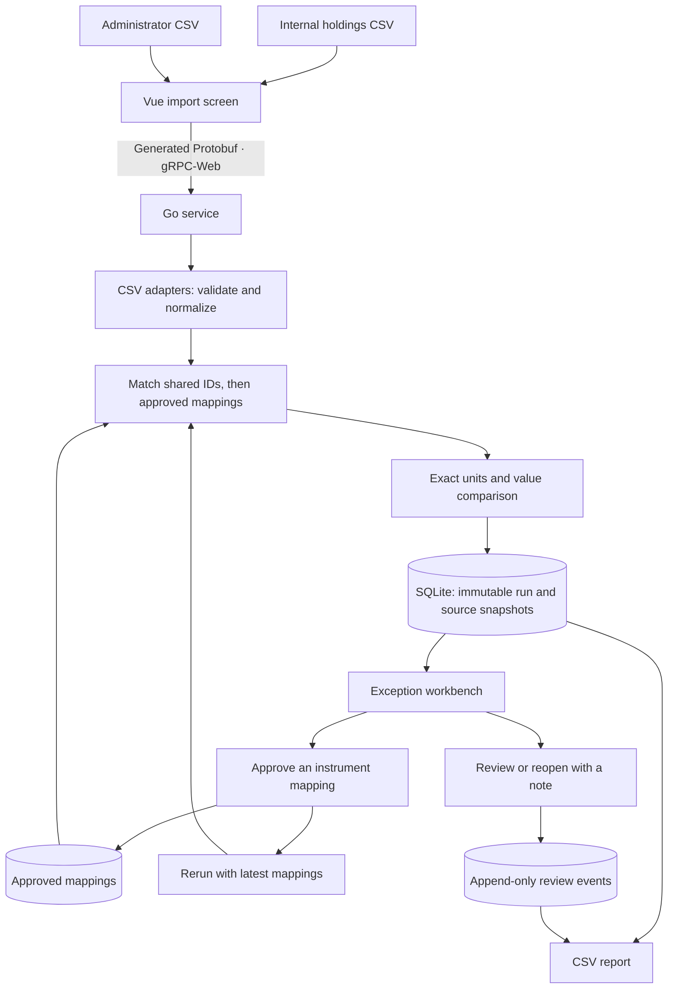

# Reconcile

**An investment data reconciliation workbench built with Go, Vue, TypeScript, Protobuf and gRPC-Web.**

Two providers describe the same holdings differently. Reconcile imports their CSV files, matches instrument identities, highlights quantity and valuation differences, and records how each exception was investigated.

The key distinction: approving an instrument's identity does **not** make its balances agree. Reviewing a discrepancy records a decision without erasing the difference.

## Run locally

Install Node.js 22.12+ (Node 24 recommended). In PowerShell, from this repository:

```powershell
./scripts/setup.ps1
./scripts/run.ps1
```

Open **http://127.0.0.1:8081**. Setup downloads a checksum-verified Go toolchain when needed. The server listens only on this computer by default. Stop it with Ctrl+C and run the same command to restart; saved work stays in `data/reconcile.db`.

On other platforms, install Go 1.27.1 and Node, then:

```sh
npm ci --prefix web
npm run build --prefix web
go run ./cmd/server
```

## A three-minute demonstration

1. Click **Try the sample portfolio**. Six fictional holdings per source include exact matches, quantity/value differences and unpaired records.
2. Inspect **EXT-001**. It has no shared security ID, so a similar name does not automatically match it.
3. Select **FUND-A**, enter your name and an explanation, then **Approve mapping**.
4. Click **Rerun comparison** and inspect **FUND-A**. The mapping resolves identity, but the administrator still reports **20 fewer units** and **ZAR 2,400 less value**.
5. Add a review note and **Mark reviewed**. The original discrepancy remains visible. Reopen it to append another event.
6. Export CSV, open the earlier run from history, then restart the server to demonstrate persistence.

Reviewer names are self-entered local-demo metadata. All supplied holdings are fictional.

## System flow



## What the system demonstrates

| Concern | Implementation |
| --- | --- |
| Different source formats | Two strict CSV adapters; physical source row numbers and original fields retained |
| Identity | Shared security ID first, explicit mapping second, no fuzzy name matching |
| Accuracy | Units stored as integers scaled by 1,000,000; money stored in cents; browser formats `bigint` |
| Explainability | Each item shows both sources, match basis, signed deltas and source fingerprints |
| History | Each rerun is a new immutable snapshot linked to its parent |
| Human review | Required reviewer, reason and note; reopening appends an event |
| Reliability | SQLite transactions, mutation retry IDs and expected review revisions |
| API contracts | Generated Go and TypeScript from one Protobuf service; native gRPC and gRPC-Web supported |
| Export | Current review state and latest note; missing holdings remain blank; spreadsheet-facing text is formula-safe |

## Bring your own fictional files

Download the sample files from **New import**, or use `web/public/samples/`.

Internal headers:

```csv
instrument_id,instrument_name,as_of,currency,units,market_value
```

Administrator headers:

```csv
provider_code,security_id,description,valuation_date,ccy,quantity,value
```

Both files must use UTF-8 and the exact header order. A single valuation date must agree across both sources. IDs are trimmed and uppercased; duplicates are rejected. Only ZAR is supported. Units allow six decimal places, values allow two, and both must be positive and at most 1,000,000,000. Each file allows up to 1,000 holdings and 1 MiB. Blank `security_id` values require an approved mapping. Nonempty security IDs cannot be overridden by a mapping.

Approved mappings affect future runs. Version one permits creating and inspecting mappings, with no replacement or deletion. The database is a local application audit trail, not cryptographic proof against database tampering. Public hosting and its storage/access model are planned separately.

## Development and verification

```powershell
./scripts/test.ps1      # Go tests, go vet, frontend build, Edge browser tests
./scripts/generate.ps1  # Regenerate Go/TypeScript after editing the proto
```

Windows browser tests use Microsoft Edge. On Linux/macOS, build `bin/reconcile`, install Playwright Chromium (`npx playwright install chromium` from `web`), and run `npm test --prefix web`. Each browser run uses a separate database under ignored `data/`.

For frontend development, run the Go server and then `npm run dev --prefix web`. Vite proxies the service to port 8081.

```text
proto/                 Shared API contract
gen/                   Generated Go messages and service bindings
internal/domain/       CSV parsing, exact arithmetic, matching
internal/store/        SQLite transactions, history, export
internal/transport/    gRPC-Web / gRPC handlers
cmd/server/            Local server and frontend hosting
web/src/               Vue workbench and generated TypeScript
web/tests/             Browser workflow tests
```

See [the interview walkthrough](docs/interview-walkthrough.md) for an explanation using Angular, React, C# and Java comparisons.
